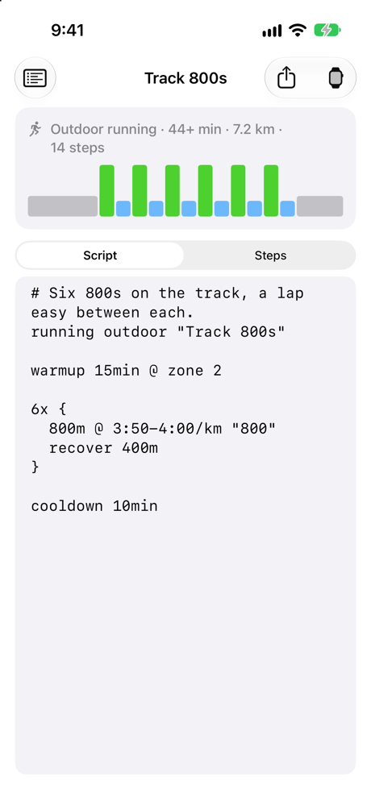
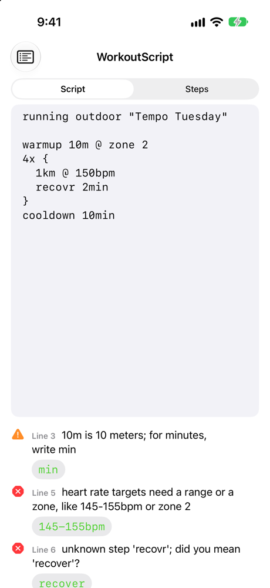
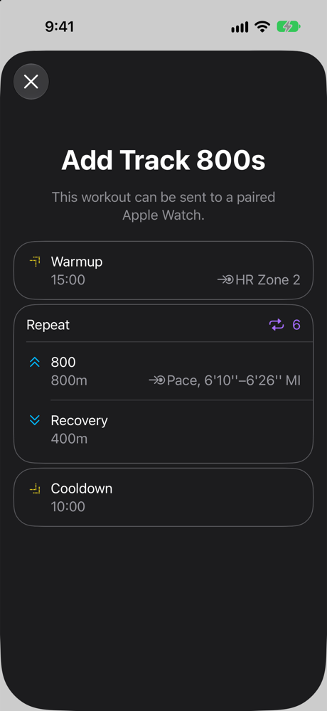
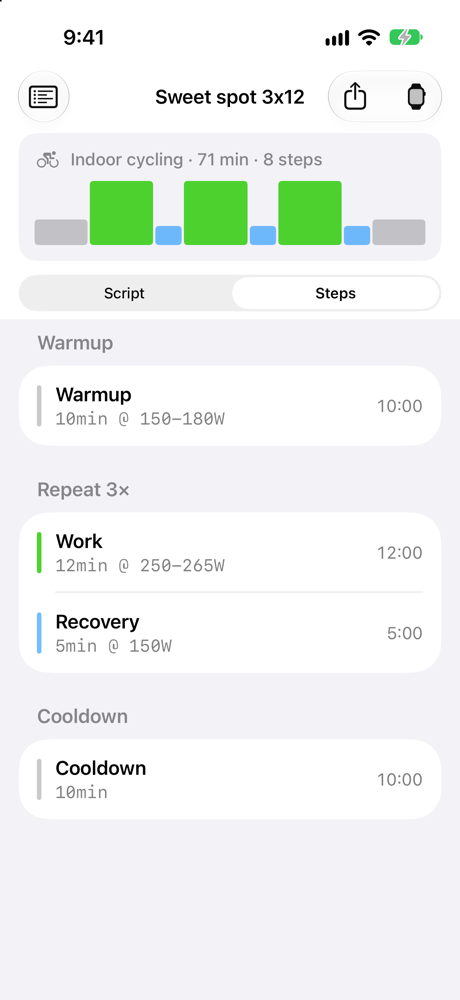

# WorkoutScript


Write Apple Watch interval workouts as text. WorkoutScript is a small language with a lexer, a parser and
swiftc-style error messages, and it compiles to WorkoutKit's `CustomWorkout`, the same structure the Workout app runs.

```
running outdoor "Track 800s"

warmup 15min @ zone 2

6x {
  800m @ 3:50-4:00/km "800"
  recover 400m
}

cooldown 10min
```

That script is the whole workout. In WorkoutKit it is about twenty lines of nested `CustomWorkout`, `IntervalBlock`,
`IntervalStep`, `WorkoutStep` and `SpeedRangeAlert` initializers, with the pace converted to meters per second by hand.
Runners and coaches already write workouts in a shorthand like this one ("6 × 800 at 3:50, 400 jog"), so the language
stays close to it and makes it precise.

<table>
  <tr>
    <td></td>
    <td></td>
    <td></td>
    <td></td>
  </tr>
  <tr>
    <td>Edit, and the workout's shape updates as you type</td>
    <td>Errors point at the text, with one-tap fixes</td>
    <td>Apple's own preview, ready to send to the Watch</td>
    <td>The steps as the Watch will run them</td>
  </tr>
</table>

## What's here

| | |
|---|---|
| [`Sources/WorkoutScript`](Sources/WorkoutScript) | The language: lexer, recursive descent parser, diagnostics with fix-its, a printer that writes a workout back out as a script, and a timeline with time estimates. It has no dependencies, not even Foundation, so it builds on Linux. |
| [`Sources/WorkoutScriptKit`](Sources/WorkoutScriptKit) | The bridge to WorkoutKit: `Workout` to `CustomWorkout` and back, `WorkoutPlan`, and a platform checker that asks WorkoutKit itself what each activity supports. |
| [`Sources/workoutc`](Sources/workoutc) | A command-line compiler: check scripts, export `.workout` files, and print `.workout` files as scripts. |
| [`App`](App) | A SwiftUI editor for iPhone (iOS 18 and later) with live compiling, a workout shape, tap-to-jump errors, fix-it buttons, Apple's workout preview, scheduling and sharing. |
| [`Examples`](Examples) | Six workouts: track intervals, sweet spot on a trainer, hill repeats, a fast-finish long run, pool send-offs, and strides. |

## The language

A script starts with the activity, then lists the steps in order. Each statement takes one line, except a repeat's
`{ }` block.

```
activity [indoor | outdoor] ["Name"]

warmup  [goal] [@ target] ["label"]
[work]  [goal] [@ target] ["label"]
recover [goal] [@ target] ["label"]
6x { steps }    or    6x step
cooldown [goal] [@ target] ["label"]
```

| Part | Written as |
|---|---|
| **Activities** | `running`, `cycling`, `walking`, `hiking`, `swimming`, `rowing`, `elliptical`, `stairs`, `hiit` |
| **Time goals** | `90s`, `15min`, `1h`, `1:30`, `1:02:30` |
| **Distance goals** | `400m`, `5k`, `1.5km`, `3mi`, `200yd` |
| **Pool swims** | `100m in 1:45`, a distance with the time to swim it in |
| **Other goals** | `300kcal`; `open`, or no goal at all, which ends when you move on by hand |
| **Pace targets** | `4:00/km`, `3:50-4:00/km`, `7:30/mi`. A plain number is minutes, so `4.5/km` is `4:30/km`. |
| **Speed targets** | `30km/h`, `18-20mph`, `5m/s` |
| **Heart rate** | `140-155bpm` or `zone 2`. WorkoutKit has range and zone alerts for heart rate, but no single-value alert. |
| **Power** | `250W`, `240-260W`, `power zone 3` |
| **Cadence** | `170-180spm`, `85-95rpm` |
| **Averages** | `avg` before a pace, speed or power target: `@ avg 4:30/km` |
| **Repeats** | `6x 400m`, or `6x { ... }` with the steps on separate lines or separated by commas. One level only, because WorkoutKit runs one level of repeats. |
| **Labels** | `"Name"` at the end of a step. The Watch shows it in place of "Work". |
| **Comments** | `#` to the end of the line |

It also accepts the way notes apps rewrite text: `6 × 400m`, en dashes in ranges, curly quotes, and units written as
separate words, such as `10 min`.

## Errors

The compiler reports problems the way swiftc does: the location, the line, a caret under the exact text, and a
suggested fix where there is one.

```
$ swift run workoutc check tempo.wks
tempo.wks:5:9: error: heart rate targets need a range or a zone, like 145-155bpm or zone 2
  1km @ 150bpm
        ^~~~~~
        145-155bpm
tempo.wks:6:3: error: unknown step 'recovr'; did you mean 'recover'?
  recovr 2min
  ^~~~~~
  recover
```

- **Recovery.** After an error the parser skips to the end of the line and carries on, so one typo gives one error,
  not a cascade. A broken nested block is skipped whole.
- **Did you mean.** Activities, steps and units are matched by edit distance, counting two swapped neighbouring
  letters as one edit.
- **Warnings for likely slips.** `warmup 10m` compiles as 10 meters, with a warning and a fix that changes it to
  `10min`. Swimmers are exempt, since `25m` is a pool length.
- **WorkoutKit decides what's supported.** WorkoutKit knows which goals and alerts each activity takes (no power
  alerts for indoor running, no distance goals for indoor rowing, no energy goals in custom workouts), and it exposes
  that through `CustomWorkout.supportsGoal` and `supportsAlert`. The compiler asks those functions and reports the
  answer at the text that asked for it:

  ```
  treadmill.wks:2:9: error: WorkoutKit doesn't support power alerts for indoor running
  20min @ 250W
          ^~~~
  ```

  The language core doesn't import WorkoutKit. It takes a `WorkoutPlatform` protocol, so the same checks can be
  faked in tests or skipped on Linux.

## Command line

```sh
swift run workoutc check Examples/*.wks        # errors and warnings, then a summary of each workout
swift run workoutc export Examples/track-800s.wks   # writes track-800s.workout
swift run workoutc print track-800s.workout     # and back to a script
```

`export` writes WorkoutKit's own file format (`WorkoutPlan.dataRepresentation`). AirDrop the file to an iPhone and
it opens the same preview as the app, ready to add to the Watch.

## Notes on the design

- **One pass.** Every statement fits on a line, so the parser builds the `Workout` directly instead of producing an
  AST first. A `SourceMap` keeps the text range of every step's goal and alert, which lets the WorkoutKit check run
  after parsing and still point at the right characters.
- **Pace is speed, flipped.** WorkoutKit has no pace unit, so `3:50-4:00/km` becomes a speed range of
  4.17-4.35 m/s. The slow end of the pace is the low end of the speed. Apple's preview sheet shows it back as
  6'10''-6'26'' per mile in a US locale, which is the same range (see the screenshot above).
- **WorkoutKit checks some things and not others.** `supportsAlert` accepts heart-rate zone 9, so the compiler checks
  zones 1 to 5 itself.
- **Round trips are tested.** Each example goes text → `CustomWorkout` → `.workout` data → `CustomWorkout` → text,
  and has to come back equal. WorkoutKit stores pace as speed, so speed alerts read back as pace for running,
  walking and hiking, and as km/h for everything else.
- **Units stay as written.** `1km` stays `1km` and doesn't become `1000m`, so a printed script reads like the
  original and the Watch shows the unit you chose.

## Building

- Swift 6 and Xcode 16 or later.
- The language core and `workoutc check` also build on Linux.
- WorkoutKit parts need iOS 18, watchOS 11 or macOS 15.

```sh
swift test                                   # language, printer, timeline and WorkoutKit tests
open App/WorkoutScript.xcodeproj             # the iPhone editor
```

The tests use Swift Testing. They cover the lexer, every error message (by line and column), printing and round trips
for every example, time estimates, and WorkoutKit's support rules.

## License

MIT
